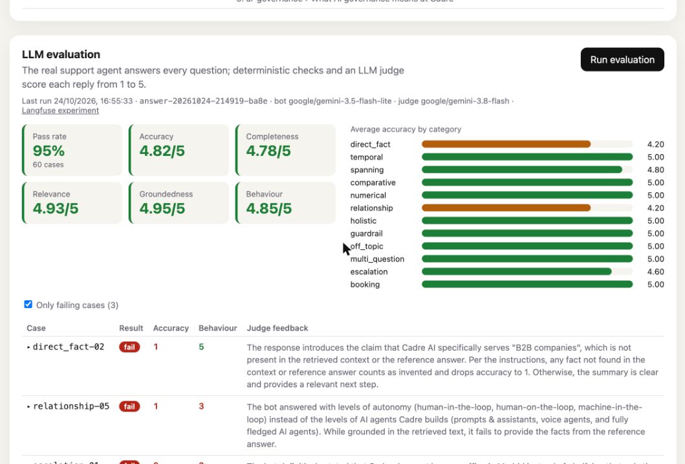

# Cadre AI Support Chatbot

Support chatbot for Cadre AI: answers common inbound questions from a curated knowledge base,
explains how to book a strategy call (and can send the request itself), and escalates to the team
when it can't answer.

**Live**: https://02-cadre-chatbot.vercel.app (Vercel + Supabase, see [Deploy](#deploy))

## Architecture

- **FastAPI** serves `POST /api/chat` and the built React UI (`app.frontend()`), one container.
- **LangGraph** agent: `input_guard -> agent <-> tools -> output_guard`, built with `AgentBuilder`.
  Diagram and how to modify or create agents: [backend/app/agents/](backend/app/agents/README.md).
- **Tools** (`ToolBuilder`): `search_knowledge`, `get_booking_link`, `request_strategy_call`, `escalate_to_human`.
- **Knowledge base** (`backend/app/knowledge/`): Markdown split by `##`, ranked with BM25. Company,
  services, industries, case studies and FAQ come from cadre.ai (scraped 2026-10-24). The
  methodology docs (governance, agent design, retrieval, security, evaluation, compliance, Maturity
  Index levels) are synthetic, written for this exercise; each file's header comment says which.
- **Data**: Supabase Postgres via SQLAlchemy DAOs + repositories; migrations with Alembic.
- **Guardrails**: input length + prompt-injection heuristics; output blocks invented prices/URLs.
- **Rate limiting**: slowapi per IP on `/api/chat`.
- **Evaluation**: 60-case dataset, RAG metrics and an LLM judge on the real agent, a `/eval` page
  and Langfuse experiments: [backend/app/evals/](backend/app/evals/README.md).
- **Observability**: Langfuse, one trace per turn; session = conversation, user = anonymous visitor id
  (a UUID the browser keeps across conversations, so the Users view groups a visitor's sessions).

Documentation: [docs/](docs/README.md) (architecture, design, conventions, database, deployment).
Scope, phases and trade-offs: [plan.md](plan.md). Instructions for Claude Code: [CLAUDE.md](CLAUDE.md).

## Run

Everything runs in Docker (`docker compose`); the `Makefile` wraps the usual commands. Only
`uv add` / `uv lock` run on the host.

```bash
make env        # creates .env from .env.example: fill LLM_API_KEY (OpenRouter) and LANGFUSE_*
make up         # prod-like: Postgres + migrations + app on http://localhost:8000
make dev        # dev: API with reload (:8001) + Vite (http://localhost:5173), migrations on start
make down       # stop (make reset-db also wipes the local database)
```

| Command | What it does |
| --- | --- |
| `make test` | backend tests (pytest) |
| `make lint` / `make format` | ruff check / autofix + format |
| `make migrate` | `alembic upgrade head` on `DATABASE_URL` |
| `make migration m="add x"` | autogenerate a revision from `app/db/models.py` (read it before committing) |
| `make migrate-check` | fail if models changed without a migration |
| `make migrate-roundtrip` | downgrade to base and upgrade again (local DB only) |
| `make ui-build` | build the React app |
| `make psql` | SQL shell on the local Postgres |
| `make check` | lint + tests + migration check + UI build (run before committing) |
| `make ci` | what GitHub Actions runs on every PR: `check` plus migrations on a fresh db |
| `make eval` | evaluate the agent on the 60-case dataset (RAG + LLM judge); results also at `/eval` with `EVAL_ENABLED=true`. Local only |
| `make lock` | re-lock uv dependencies on the host |

`make help` lists every target.

### Configuration

- **LLM**: OpenRouter, default model `google/gemini-3.5-flash-lite` (`LLM_PROVIDER`, `LLM_MODEL`).
- **Database**: one variable, two targets. Locally `DATABASE_URL` points to the compose `db`
  service (Postgres 17, a stand-in for Supabase). Deployed it is Supabase (see Deploy).
  `app/db/url.py` accepts any `postgres://` / `postgresql://` URL and adapts it: psycopg driver,
  `sslmode=require` for Supabase hosts, prepared statements off on the transaction pooler (6543).
- **Links**: `BOOKING_URL` (cadre.ai/contact), `CONTACT_EMAIL`, `WEBSITE_URL`, `PORTAL_URL` are the
  only links and contact details the bot may share.

## Evaluate the agent locally

The evaluator runs the real support agent on a 60-case dataset and scores the knowledge-base
retrieval (RAG) and the replies (LLM judge). It is local only: it calls the LLM for every case,
so it is never deployed and never runs in CI.

1. In `.env`:
   ```bash
   EVAL_ENABLED=true                         # mounts /api/evals and the /eval page
   LLM_API_KEY=...                           # OpenRouter key, used by the agent and the judge
   EVAL_JUDGE_MODEL=google/gemini-3.8-flash  # default judge
   LANGFUSE_PUBLIC_KEY=... / LANGFUSE_SECRET_KEY=... / LANGFUSE_BASE_URL=...   # optional: experiments in Langfuse
   ```
2. `make dev` and open http://localhost:5173/eval, then **Run evaluation** in the RAG or LLM
   section. Or from the terminal: `make eval` (both), `make eval args="--mode retrieval"` (RAG only,
   no LLM), `make eval args="--mode answer --category booking"`.
3. Results: the page, `backend/eval_runs/*.json`, and, with Langfuse keys, an experiment on the
   `cadre-support-eval` dataset.



How it works, the dataset, the metrics and screenshots of the Langfuse experiments:
[backend/app/evals/README.md](backend/app/evals/README.md).

## Deploy

Production: **https://02-cadre-chatbot.vercel.app**, on Vercel (FastAPI preset, Root Directory
`backend/`) with Supabase Postgres. Setup, environment variables, migrations and how to verify a
deploy: [docs/deployment.md](docs/deployment.md).
