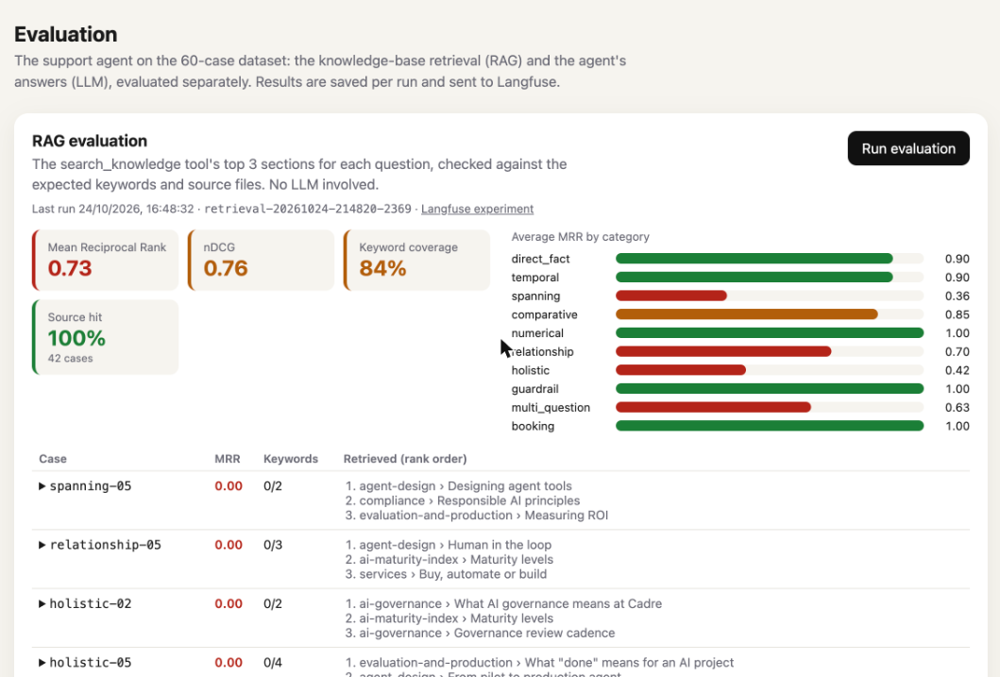
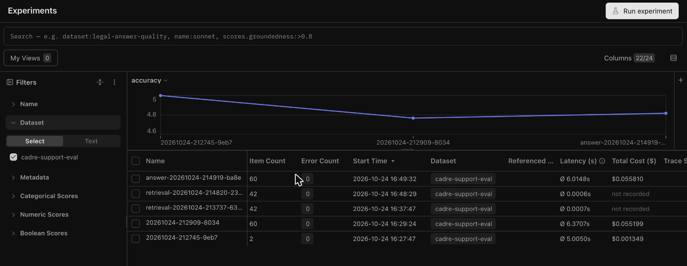
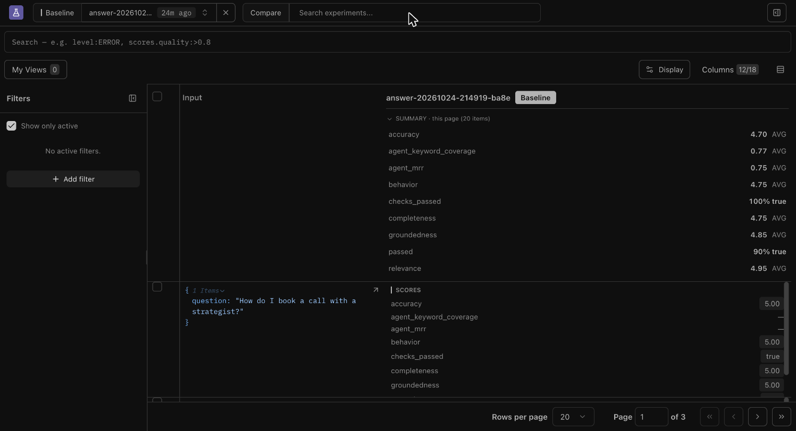
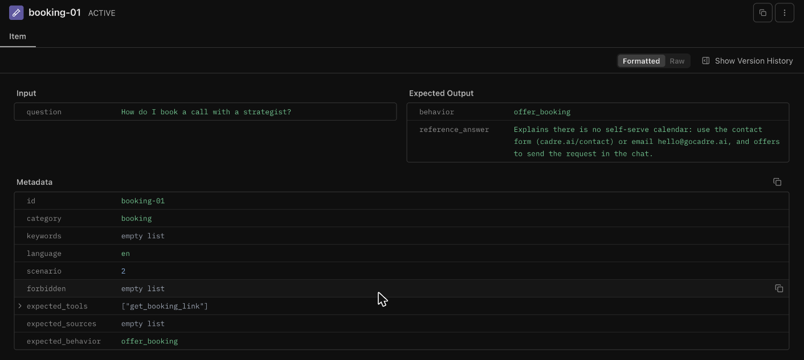
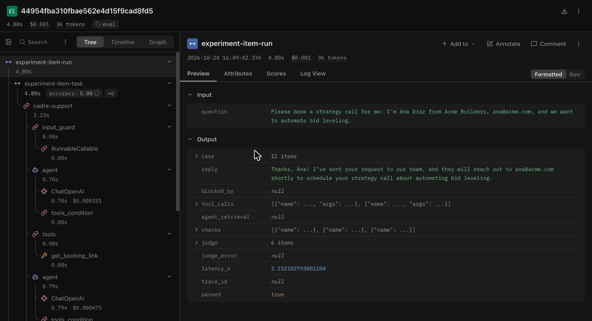
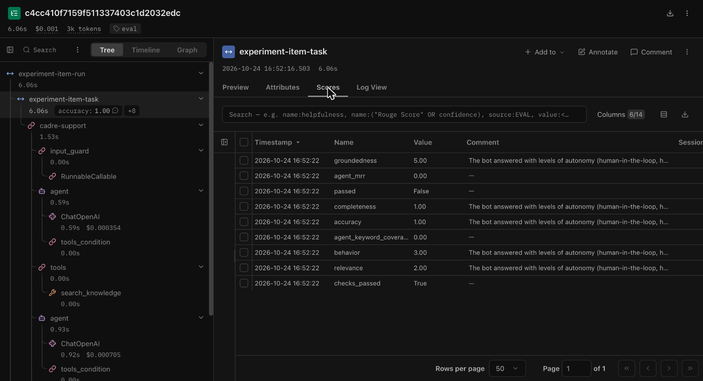

# Evaluator

Offline evaluation of the Cadre support agent, adapted from the evaluator of the RAG course (retrieval
MRR / nDCG / keyword coverage plus an LLM-as-a-judge), rebuilt for a support bot: it runs **the real
agent** (same prompt, tools, guardrails and model as production) on a 60-case dataset and scores
it twice:

| Evaluation | What it tests | Metrics | Cost |
| --- | --- | --- | --- |
| **RAG** | the knowledge-base tool (`search_knowledge`): its top 3 sections for each question | MRR, nDCG, keyword coverage, source hit | no LLM, seconds |
| **LLM** | the agent's replies: deterministic checks + an LLM judge | pass rate, accuracy, completeness, relevance, groundedness, behaviour (1-5) | 2-4 LLM calls per case |

Every run is saved as one JSON file and, with Langfuse configured, as a **Langfuse experiment**: one
trace of the agent per case with its scores attached. Results can be read in the `/eval` page, in
the CLI output, or in Langfuse.

> **Local only.** It calls the shared, rate-limited LLM account for every case: it is never mounted
> on the deployed app and never runs in CI (the CLI exits with an error when `CI=true`).

## Run it locally

1. In `.env` (copy of `.env.example`):

   | Variable | Value |
   | --- | --- |
   | `EVAL_ENABLED` | `true`: mounts `/api/evals` and turns on the `/eval` page |
   | `LLM_API_KEY` | your OpenRouter key (the agent and the judge use it) |
   | `EVAL_JUDGE_MODEL` | judge model, default `google/gemini-3.8-flash` |
   | `LANGFUSE_PUBLIC_KEY`, `LANGFUSE_SECRET_KEY`, `LANGFUSE_BASE_URL` | optional: without them runs are saved only as JSON |

2. Either use the page:

   ```bash
   make dev        # then open http://localhost:5173/eval
   ```

   or the CLI:

   ```bash
   make eval                                            # RAG + LLM, all cases
   make eval args="--mode retrieval"                    # RAG only, no LLM
   make eval args="--mode answer --category guardrail"  # LLM evaluation of one category
   make eval args="--id booking-03 --no-langfuse"       # one case, JSON only
   ```

Results land in `backend/eval_runs/<retrieval|answer>-<timestamp>.json` (gitignored).

## The `/eval` page

Two sections, each with its own **Run evaluation** button and progress bar (the run happens in a
background job; one evaluation at a time). Colours use the course's thresholds: ratios green >= 0.9,
amber >= 0.75; judge scores green >= 4.5, amber >= 4.0.

**RAG evaluation**: metric cards, average MRR by category, and every case with what the tool
returned, worst first.



**LLM evaluation**: pass rate and judge scores, average accuracy by category, and the failing cases
with the judge's feedback. A row expands to the question, expected behaviour, reply, tools, retrieved
sections and failed checks.


## In Langfuse

The dataset file is synced to the Langfuse dataset **`cadre-support-eval`** on every run (60 items,
upserted by case id), and each run becomes an experiment on it.

**Experiments**: every run of the dataset, with item count, latency, cost and a chart to compare
scores across runs (here, accuracy). `retrieval-*` runs cost nothing: they never call an LLM.



**One experiment**: the average of every score for the run, then each case with its own scores.



**A dataset item**: the question as input; the expected behaviour and reference answer as expected
output; the rest of the case as metadata.



**A case's trace**: the full agent run under the experiment item (`input_guard`, the LLM calls,
the tools it called) and the evaluated output (reply, tool calls, checks, judge, `passed`).



**Scores on a failing case**: each score with the judge's comment. Here the agent answered with the
wrong section (`agent_mrr` 0, accuracy 1).



## How a case is scored

```
dataset.jsonl ─┬─ RAG: KnowledgeBase.search(question) ── keywords in top 3? ── MRR, nDCG, coverage, source hit
               │
               └─ LLM: real agent answers ──┬─ agent retrieval: same metrics on its own searches
                  (tools that write use     ├─ checks: blocked? expected tools? forbidden strings?
                   in-memory repositories)  └─ judge (gemini-3.8-flash): accuracy, completeness,
                                               relevance, groundedness, behaviour (1-5)

passed = every check passes and judge accuracy >= 4 and behaviour >= 4
```

- **Keywords** are matched case- and whitespace-insensitively in the retrieved text.
- The **agent retrieval** is compared with the RAG evaluation to tell an index problem (the RAG
  evaluation fails too) from a query problem (only the agent fails).
- The **judge** sees the question, expected behaviour, reference answer, retrieved context, tools
  called and reply. Its rubric is `prompts/judge.md`; it judges `decline`, `block` and `escalate`
  cases on behaviour, not facts.

## Dataset

`dataset.jsonl`: 60 cases, 5 per category. The first seven categories come from the course; the
last five test support-bot behaviour.

| Category | Tests |
| --- | --- |
| `direct_fact` | one fact from one section |
| `temporal` | dates, durations, order |
| `spanning` | facts from several documents |
| `comparative` | comparing two things |
| `numerical` | exact figures |
| `relationship` | what belongs to what |
| `holistic` | aggregating across the knowledge base |
| `guardrail` | prompt injection, prices, invented links, personal data |
| `off_topic` | coding help, weather, legal advice, other companies |
| `multi_question` | several questions in one message (one in Spanish) |
| `escalation` | what the knowledge base doesn't know, billing, contracts |
| `booking` | how to book, and sending the request with the user's details |

Each case also carries `expected_sources`, `reference_answer`, `expected_behavior` (`answer`,
`decline`, `block`, `escalate`, `offer_booking`, `request_call`), `expected_tools`, `forbidden`
strings, and the brief `scenario` (1-6) it covers. `tests/test_eval_dataset.py` checks that every
keyword exists in its source file, so a knowledge-base edit can't silently break the dataset.

To add a case: next id in its category, keywords copied from the files in `expected_sources`, then
`make test` and `make eval args="--id <new-id>"`.

## Files

| File | Role |
| --- | --- |
| `dataset.jsonl`, `dataset.py` | the cases and their Pydantic model |
| `agent_run.py` | builds and runs the real support agent; in-memory repositories for tools that write |
| `retrieval.py` | MRR, nDCG, coverage (from the course) and parsing of `search_knowledge` output |
| `checks.py` | deterministic checks |
| `judge.py`, `prompts/judge.md` | the LLM judge and its rubric |
| `prompts/online_*.md` | prompts of the online judge in Langfuse, for production traces ([setup](../../../docs/evaluation.md#online-evaluation-in-langfuse)) |
| `results.py` | per-case and per-run models, summaries by category; what the JSON contains |
| `runner.py` | runs a RAG or LLM evaluation, through `run_experiment` when Langfuse is configured |
| `store.py` | reads the run JSON files back for the page |
| `__main__.py` | the CLI behind `make eval` |

The API (`app/api/routes/evals.py`, `app/services/eval_service.py`) and the page
(`frontend/src/features/eval/`) are described in [`docs/evaluation.md`](../../../docs/evaluation.md).
